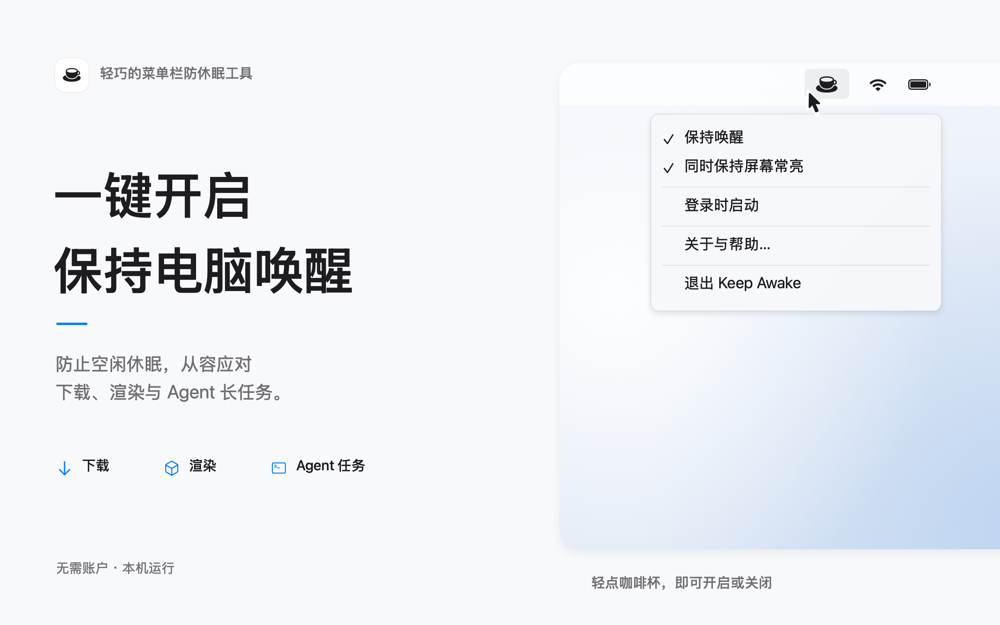
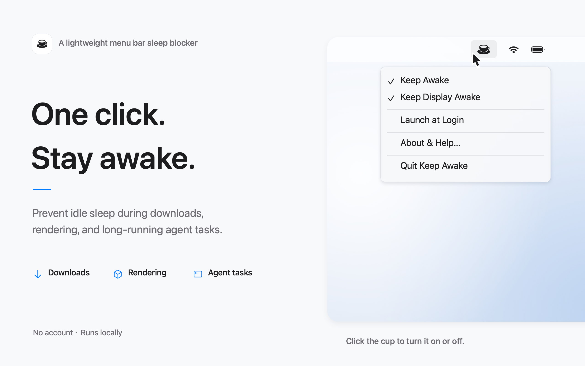
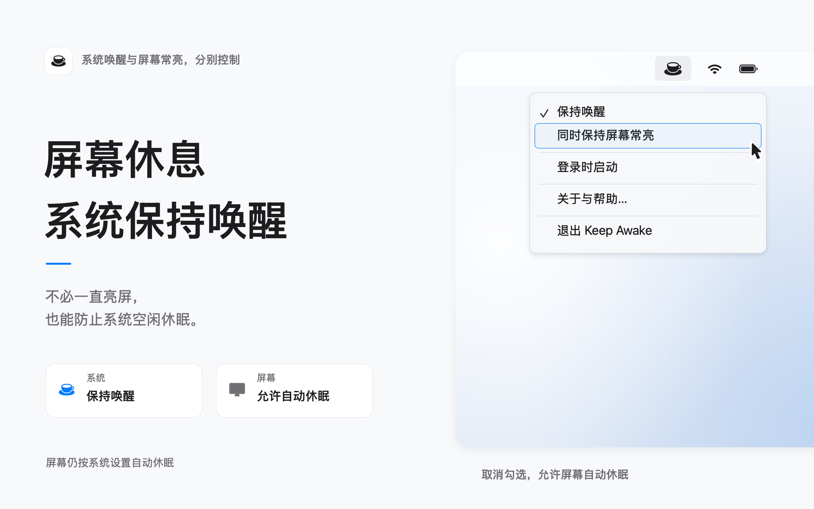
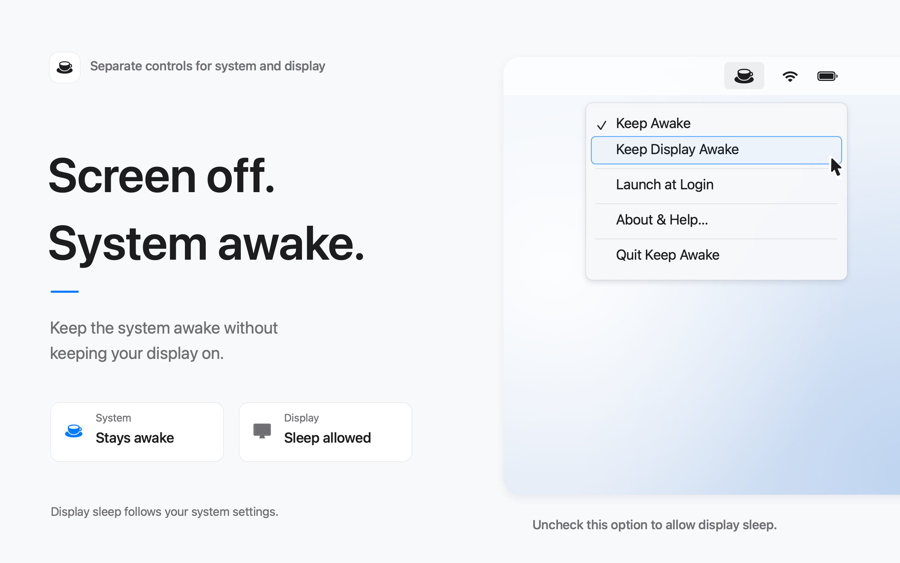
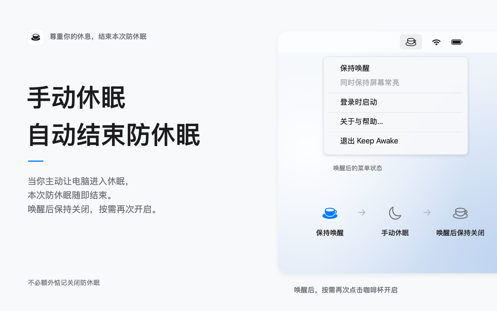
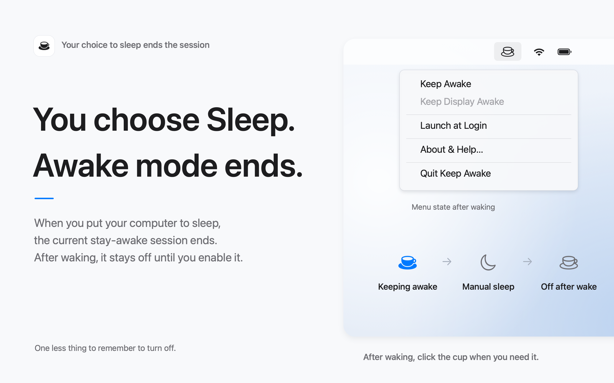
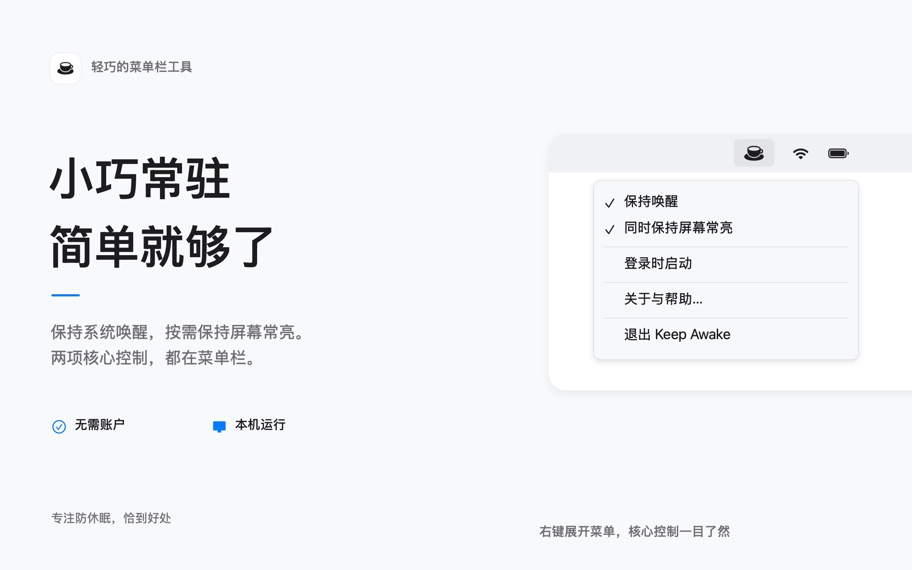
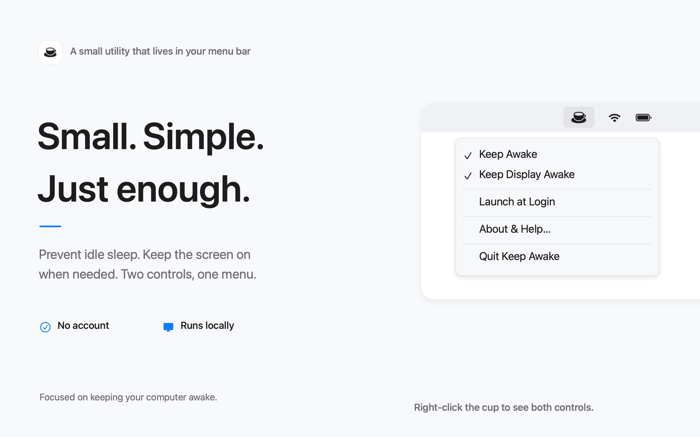
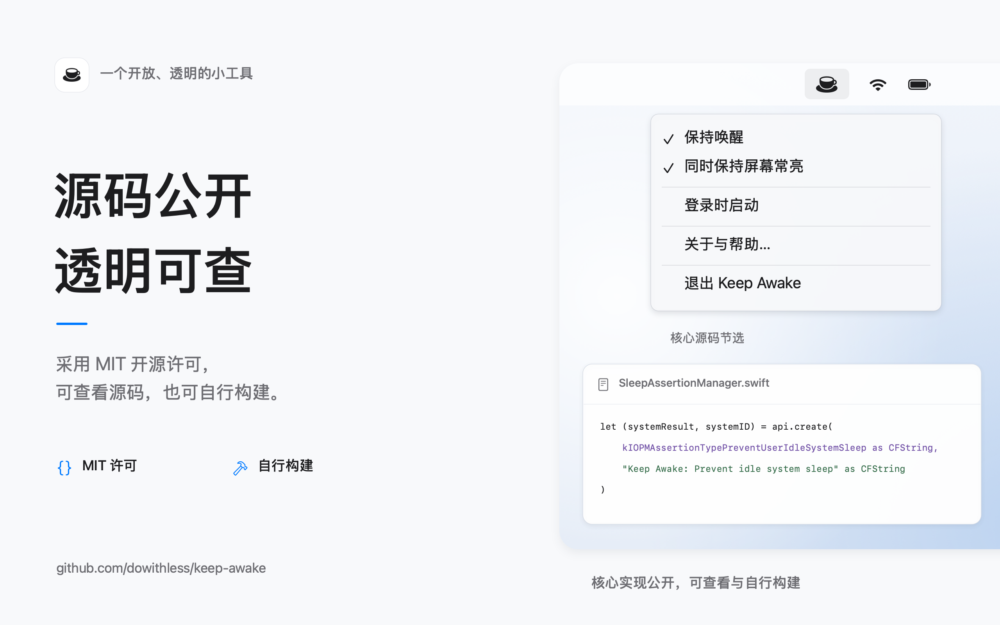
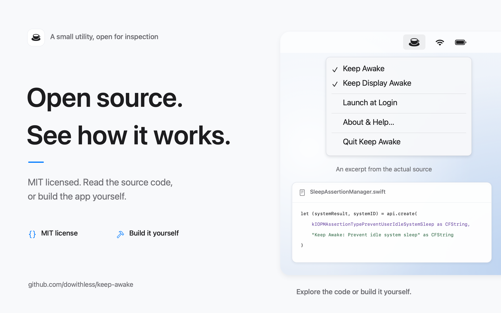

# 商店图片：11 种语言

此目录保存通过同一模板生成的商店图片，不属于应用资源，不打包进安装包。

上传时可先查看[语言代码与中文名称对照](语言代码与中文名称对照.md)，按文件夹代码匹配商店页面的语言选项。

- `zh-Hans/`：简体中文，五张均与此前确认版本逐字节一致。
- `en-US/`：英文，五张已生成并检查排版；本次批量生成保持原有图片不变。
- 其余九种语言各五张已生成并检查排版，按下方语言索引保存，共 55 张。
- 每张均为 **2560×1600、sRGB、不透明 RGB PNG**。按编号 01–05 上传到 App Store Connect 对应语言栏目。
- 第五张为开源主题。正式上传前须确认公开仓库已经包含源码和 MIT 许可证；2026-10-25 首次核对时仓库为空。

## 重生成

在仓库根目录运行：

```sh
bash Scripts/generate-store-screenshots.sh
python3 Scripts/verify-store-screenshots.py
```

脚本编译共用的 Swift 绘图模板，从 `docs/app-store/screenshot-copy.json` 读取各语言的营销文案，从 `KeepAwake/Localizable.xcstrings` 读取菜单翻译。布局、配色、图标、勾选状态和源码节选共用；长翻译仅在必要时缩小字号，超过可读范围会报错。

只生成单张时，先执行以上命令编译工具，再运行：

```sh
build/tools/generate-store-screenshot en-US 03-manual-sleep
```

默认生成全部 11 种语言；也可在命令后仅指定需要的语言，例如 `zh-Hans en-US`。中文核对记录和全部 55 张图片的 SHA-256 见 `verification.json`。字体或 macOS 版本变化可能改变渲染结果，重新生成后应再次检查。修改文案并完成视觉检查后，使用 `python3 Scripts/verify-store-screenshots.py --update-manifest` 更新导出记录；已确认的中文哈希仍须保持一致。

## 语言与上传顺序

每个文件夹仅包含该语言的五张 PNG。App Store Connect 选择对应的本地化语言后，按 01–05 上传。

| 本地化语言 | 文件夹 | 01 核心用途 | 02 独立控制 | 03 手动休眠 | 04 简洁体验 | 05 开源透明 |
| --- | --- | --- | --- | --- | --- | --- |
| 简体中文 | [zh-Hans](zh-Hans/) | [01](zh-Hans/01-keep-awake.png) | [02](zh-Hans/02-display-sleep.png) | [03](zh-Hans/03-manual-sleep.png) | [04](zh-Hans/04-simple.png) | [05](zh-Hans/05-open-source.png) |
| 英语（美国） | [en-US](en-US/) | [01](en-US/01-keep-awake.png) | [02](en-US/02-display-sleep.png) | [03](en-US/03-manual-sleep.png) | [04](en-US/04-simple.png) | [05](en-US/05-open-source.png) |
| 繁体中文 | [zh-Hant](zh-Hant/) | [01](zh-Hant/01-keep-awake.png) | [02](zh-Hant/02-display-sleep.png) | [03](zh-Hant/03-manual-sleep.png) | [04](zh-Hant/04-simple.png) | [05](zh-Hant/05-open-source.png) |
| 日语 | [ja](ja/) | [01](ja/01-keep-awake.png) | [02](ja/02-display-sleep.png) | [03](ja/03-manual-sleep.png) | [04](ja/04-simple.png) | [05](ja/05-open-source.png) |
| 韩语 | [ko](ko/) | [01](ko/01-keep-awake.png) | [02](ko/02-display-sleep.png) | [03](ko/03-manual-sleep.png) | [04](ko/04-simple.png) | [05](ko/05-open-source.png) |
| 德语 | [de-DE](de-DE/) | [01](de-DE/01-keep-awake.png) | [02](de-DE/02-display-sleep.png) | [03](de-DE/03-manual-sleep.png) | [04](de-DE/04-simple.png) | [05](de-DE/05-open-source.png) |
| 法语 | [fr-FR](fr-FR/) | [01](fr-FR/01-keep-awake.png) | [02](fr-FR/02-display-sleep.png) | [03](fr-FR/03-manual-sleep.png) | [04](fr-FR/04-simple.png) | [05](fr-FR/05-open-source.png) |
| 西班牙语（西班牙） | [es-ES](es-ES/) | [01](es-ES/01-keep-awake.png) | [02](es-ES/02-display-sleep.png) | [03](es-ES/03-manual-sleep.png) | [04](es-ES/04-simple.png) | [05](es-ES/05-open-source.png) |
| 葡萄牙语（巴西） | [pt-BR](pt-BR/) | [01](pt-BR/01-keep-awake.png) | [02](pt-BR/02-display-sleep.png) | [03](pt-BR/03-manual-sleep.png) | [04](pt-BR/04-simple.png) | [05](pt-BR/05-open-source.png) |
| 俄语 | [ru](ru/) | [01](ru/01-keep-awake.png) | [02](ru/02-display-sleep.png) | [03](ru/03-manual-sleep.png) | [04](ru/04-simple.png) | [05](ru/05-open-source.png) |
| 意大利语 | [it](it/) | [01](it/01-keep-awake.png) | [02](it/02-display-sleep.png) | [03](it/03-manual-sleep.png) | [04](it/04-simple.png) | [05](it/05-open-source.png) |

## 中英文对照

点击图片查看原始尺寸。图中菜单为按应用结构绘制的示意，源码卡片为真实源码节选。

| 顺序 | 简体中文 · zh-Hans | English · en-US |
| --- | --- | --- |
| 01 核心用途 | [](zh-Hans/01-keep-awake.png) | [](en-US/01-keep-awake.png) |
| 02 独立控制 | [](zh-Hans/02-display-sleep.png) | [](en-US/02-display-sleep.png) |
| 03 手动休眠 | [](zh-Hans/03-manual-sleep.png) | [](en-US/03-manual-sleep.png) |
| 04 简洁体验 | [](zh-Hans/04-simple.png) | [](en-US/04-simple.png) |
| 05 开源透明 | [](zh-Hans/05-open-source.png) | [](en-US/05-open-source.png) |
